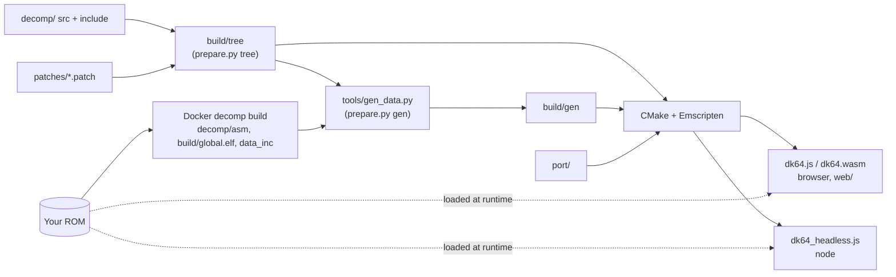

# Architecture

The game's own C, including all of its static data, comes from the decomp, pinned as the `decomp/` submodule
([Unstripped/decomp_dk64](https://github.com/Unstripped/decomp_dk64)). Nothing in `decomp/` is edited here: port
changes to game source are `patches/`, and type fixes that belong to the decomp go upstream.

## Build pipeline

1. `tools/prepare.py tree` copies `decomp/{src,include}` into `build/tree` (its own git repo, tagged `base`) and
   applies `patches/*.patch`. After a submodule bump, `tools/prepare.py rebase <old decomp commit>` replays the
   patches onto the new source with 3-way merges.
2. `tools/prepare.py gen` runs `tools/gen_data.py`, which reads the reference decomp build and writes `build/gen`.
3. CMake (Emscripten) compiles the game translation units, libultra's gu/mgu and VI mode tables, the port runtime
   and the generated sources, and links `dk64` (browser: WebGL2 + SDL2 audio/input) and `dk64_headless` (node: null
   renderer, scripted input, stats on stdout).

## Port runtime (`port/src`)

- `boot.c` replaces `src/boot/main.c` and defines the globals of it that game code reads.
- `ultra/` — libultra replacement. N64 threads are Emscripten fibers; VI, timers, PI/SI/SP and EEPROM are emulated.
- `asm/` — C rewrites of the decomp's handwritten asm.
- `gfx/` — F3DEX2 display-list interpreter plus WebGL2 backend.
- `audio/naudio.c` — HLE of the game's audio microcode.
- `endian/` — per-asset-table byte-order swappers (the game is big-endian, wasm little-endian).
- `overlay.c` — all overlays are linked in; "loading" one restores its pristine data and zeroes its bss.
- `qs.c` — quicksave snapshots.

## Notes on the port

- Memory model: wasm addresses 0–8 MB are N64 RDRAM 1:1; every game-visible static and stack lives below
  16 MB, so F3DEX2 segment math works on host pointers.
- `-sGLOBAL_BASE=8MB`: emcc rejects a hex value for this setting.
- wasm clang ignores `#pragma clang section`, so overlay data is bracketed by link-order marker objects
  (`build/web/ovl_markers/`) instead; loading an overlay restores its pristine data and zeroes its bss.
- libultra's VI mode tables are compiled from the decomp (`vitbl.c`, `vimodes/`); `port/src/boot.c` replaces
  `src/boot/main.c` and defines the globals of it that game code reads.
- Interior aliases of C objects that the decomp links by absolute address are defined with `.set` next to
  their parent (little-endian offsets); byte reads of other-width data (N64 code addresses inside function
  tables, bytes of s16 tables) use `port/shadow_data.txt` snapshots of the N64 bytes.
- Overlay functions stored in global data are `OVL_FN(type, addr)` in the decomp: the raw VRAM there, a thunk to
  the loaded overlay's function here (`build/gen/ovl_entry.c`).
- Textures in `data_inc.us.txt` blobs stay in N64 byte order (the RDP reads them so); C data is native, so a reader
  of another width than the definition needs a patch (or a fix of the decomp's type: they must match).
- Pacing: the scheduler freezes the RDP after a framebuffer swap and thaws it on the retrace that shows it; the
  port holds the next gfx task while frozen, which is what limits the game to its 30 Hz frame rate.
- IDO returned whatever was left in `$v0` from functions that fall off the end; those sites now return that
  value explicitly and game TUs build with `-Werror=return-type`.
- Framebuffer readbacks write only the RDRAM range the game asked for: a colour image's height is not in the
  display list (4:3 is assumed), and RDRAM past the real image belongs to the heap.
- Widescreen (Hor+): the canvas fills the browser window at device-pixel resolution. VI-sized colour images
  are FBOs widened to the window aspect (uncapped: on very wide windows some backdrop meshes, e.g. the main
  menu's, end before the screen edge), with the N64 image centred at `GfxFb.ox`; 3D clip x is divided by
  `gGfxTargetWide`, so the original frustum covers the centre and the sides show more scene. 2D draws keep
  their 4:3 place; scissors and fill rects spanning the width (overscan margins up to width/16 included)
  reach the edges, and the side areas are blanked once per gfx task. RDRAM uploads and readbacks use only the
  centred region. Once the side areas open, the game's overscan border around its viewport shows scene too, so
  every cull runs against the displayed span (`portGfxWideSpanX`), not the viewport: RSP x outcodes (trivial
  rejects, `G_CULLDL`), the map frustum and portal rects (`mapWideFactor`/`mapWideExtraF`, patches 0011 and
  0013) and the screen bounds objects are culled against (`portGfxWideClipX`, patch 0013).
- Draw distance: objects (trees, buildings, pickups, actors) draw and enemies spawn out to 4× the game's
  distances, capped at each map's far clip (patch 0016); `?drawdist=1` (headless `--drawdist 1`) restores N64
  behaviour, any value 1–16 sets the factor.
