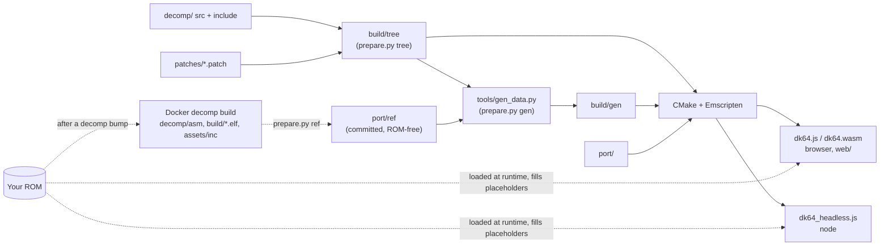

# Architecture

The game's own C, including all of its static data, comes from the decomp, pinned as the `decomp/` submodule
([Unstripped/decomp_dk64](https://github.com/Unstripped/decomp_dk64)). Nothing in `decomp/` is edited here: port
changes to game source are `patches/`, and type fixes that belong to the decomp go upstream.

## Build pipeline

1. `tools/prepare.py tree` copies `decomp/{src,include}` into `build/tree` (its own git repo, tagged `base`) and
   applies `patches/*.patch`. After a submodule bump, `tools/prepare.py rebase <old decomp commit>` replays the
   patches onto the new source with 3-way merges.
2. `tools/prepare.py gen` runs `tools/gen_data.py`, which reads `decomp/` and the committed manifest `port/ref/`
   (symbols, label sizes and widths of the reference decomp build, regenerated by `tools/prepare.py ref` after a
   decomp bump) and writes `build/gen`. Data the decomp extracts from the ROM (asm data, `data_inc` includes,
   shadow snapshots) is emitted as placeholders; `build/gen/rom_fill.c` lists where each comes from in the
   segment's inflated ROM stream, and `portRomFill` (`port/src/romfill.c`) copies it in at start, before overlay
   `.data` is snapshotted. The wasm holds no ROM bytes, so the build needs no ROM.
3. CMake (Emscripten) compiles the game translation units, libultra's gu/mgu and VI mode tables, the port runtime
   and the generated sources, and links `dk64` (browser: WebGL2 + SDL2 audio/input) and `dk64_headless` (node: null
   renderer, scripted input, stats on stdout).

## Port runtime (`port/src`)

- `boot.c` replaces `src/boot/main.c` and defines the globals of it that game code reads.
- `ultra/` — libultra replacement. N64 threads are Emscripten fibers; VI, timers, PI/SI/SP and EEPROM are emulated.
- `asm/` — C rewrites of the decomp's handwritten asm.
- `gfx/` — F3DEX2 display-list interpreter plus WebGL2 backend.
- `audio/naudio.c` — HLE of the game's audio microcode, plus two port-only commands for 3D sound.
- `audio/spatial.c`, `audio/hrtf.c` — 3D sound (see below); `audio/hrir_kemar.c` is generated by `tools/gen_hrir.py`.
- `endian/` — per-asset-table byte-order swappers (the game is big-endian, wasm little-endian).
- `overlay.c` — all overlays are linked in; "loading" one restores its pristine data and zeroes its bss.
- `qs.c` — quicksave snapshots.

## HTTP surface (`tools/serve.py`)

`tools/serve.py` is the whole server: `ThreadingHTTPServer` over `SimpleHTTPRequestHandler`, one SQLite file.

- Static files from `--dir` (`web/` plus the built `dk64.js`/`dk64.wasm`), as `python -m http.server` would serve them.
- `GET`/`PUT /api/eeprom` keep every version of the 2 KB save; `GET /api/rom` hands the browser the mounted ROM.
- `WEBBY_KONG_AUTH=1` adds the optional passkey gate (`tools/auth/`): `/auth/` splash, `/` dashboard, `/play` the game,
  `/auth/api/*` plus `/api/{me,users,invites,settings}` JSON, and a session cookie (`HttpOnly; SameSite=Lax`) in front
  of everything else. Users, credentials, sessions, invites and settings are tables in the same database file; the
  code path for an auth-less deployment is unchanged.
- Invite email is `tools/auth/mail.py` (SMTP, HTML + text), sent on demand from the dashboard, never from a queue.

## Notes on the port

- Memory model: wasm addresses 0–8 MB are N64 RDRAM 1:1; every game-visible static and stack lives below
  16 MB, so F3DEX2 segment math works on host pointers.
- `-sGLOBAL_BASE=8MB`: emcc rejects a hex value for this setting.
- Asyncify instruments every function that can reach a fiber switch, and indirect calls (printf, SDL) pull in
  most of the renderer. `gfx/` and `audio/naudio.c` never switch fibers, so both builds list their functions in
  `ASYNCIFY_REMOVE` (`tools/asyncify_remove.py`, from the `dk64_rsp`/`dk64_gl` objects). Code in those files must
  not call anything that blocks on a message queue; asyncify's asserts (ASSERTIONS) trap if it does.
- wasm clang ignores `#pragma clang section`, so overlay data is bracketed by link-order marker objects
  (`build/web/ovl_markers/`) instead; loading an overlay restores its pristine data and zeroes its bss.
- libultra's VI mode tables are compiled from the decomp (`vitbl.c`, `vimodes/`); `port/src/boot.c` replaces
  `src/boot/main.c` and defines the globals of it that game code reads.
- Interior aliases of C objects that the decomp links by absolute address are defined with `.set` next to
  their parent (little-endian offsets); byte reads of other-width data (N64 code addresses inside function
  tables, bytes of s16 tables) use `port/shadow_data.txt` snapshots of the N64 bytes.
- Overlay functions stored in global data are `OVL_FN(type, addr)` in the decomp: the raw VRAM there, a thunk to
  the loaded overlay's function here (`build/gen/ovl_entry.c`).
- Textures in `data_inc.us.txt` blobs stay in N64 byte order (the RDP reads them so); C data is native, so a reader
  of another width than the definition needs a patch (or a fix of the decomp's type: they must match).
- Pacing: the scheduler freezes the RDP after a framebuffer swap and thaws it on the retrace that shows it; the
  port holds the next gfx task while frozen, which is what limits the game to its 30 Hz frame rate. Game logic
  stays at that rate: most of it counts frames (cutscenes, actor timers), so running it every VI doubles its speed.
- 60 fps by interpolation (`gfx.c`, "frame interpolation"): after a task that draws the VI image, the renderer
  runs its display list again at the start of the next VI with every matrix halfway between this frame's and the
  previous frame's, into a twin of the VI image with its own depth buffer; `port_frame_step` presents it on the
  VI between the two swaps, so the game frames keep their VIs and no latency is added. A matrix pairs with the
  previous frame's matrix of the same load kind and first-transformed vertex address in the same draw position,
  unless another of those is under half as far (instances sharing a mesh, like trees, change draw order between
  frames; parts of one model can share a translation). A matrix whose vertices sit in a buffer the CPU alternates
  every frame (shadows) pairs with the nearest previous one (within 100 units) whose vertices are no longer loaded.
  Unmatched or jumping matrices (cuts, spawns; a turn of roughly 90° or more) keep the frame's value. The replay
  repeats the first pass's `G_BRANCH_Z`/`G_CULLDL` outcomes and
  leaves RDRAM, the colour images and the shared depth as the frame left them. Not in the headless build. Player
  setting (`--interp`, `?interp=`, Esc menu "Frame rate", `port_set_interp`): off drops the pending replay and any
  waiting in-between image; switching back pairs matrices from the next two game frames, never a stale one.
- Depth readback: the game reads the z-buffer every gameplay frame (`zbufferReadDepth`: sun and camera probes),
  one pixel per call, and syncs only that pixel (patch 0008). A shader converts the depth image to the RDP's 16-bit
  z format, two pixels per RGBA8 texel, which is read into a pixel-pack buffer at the end of each task and copied
  to host memory before the replay is queued, so those reads no longer wait for the GPU; each copies just its pixel.
- IDO returned whatever was left in `$v0` from functions that fall off the end; those sites now return that
  value explicitly and game TUs build with `-Werror=return-type`.
- Framebuffer readbacks write only the RDRAM range the game asked for: a colour image's height is not in the
  display list (4:3 is assumed), and RDRAM past the real image belongs to the heap.
- Widescreen (Hor+): the canvas fills the browser window at device-pixel resolution. VI-sized colour images
  are FBOs widened to the window aspect (uncapped: on very wide windows some backdrop meshes, e.g. the main
  menu's, end before the screen edge), with the N64 image centred at `GfxFb.ox`; 3D clip x is divided by
  `gGfxTargetWide`, so the original frustum covers the centre and the sides show more scene. 2D draws keep
  their 4:3 place; scissors and fill rects spanning the width (overscan margins up to width/16 included)
  reach the edges, and the side areas are blanked once per gfx task. The screen wipe (e.g. warp pads) draws a
  4:3 capture of the screen over the new scene, with tiles reaching past its scissor; afterwards a
  `PORT_GFX_BLANK_SIDES` `G_NOOP` tag (patch 0026) blacks everything left and right of the scissor, overscan
  border and side areas, as the N64 shows it. RDRAM uploads and readbacks use only the
  centred region. Once the side areas open, the game's overscan border around its viewport shows scene too, so
  every cull runs against the displayed span (`portGfxWideSpanX`), not the viewport: RSP x outcodes (trivial
  rejects, `G_CULLDL`), the map frustum and portal rects (`mapWideFactor`/`mapWideExtraF`, patches 0011 and
  0013) and the screen bounds objects are culled against (`portGfxWideClipX`, patch 0013).
- Draw distance: objects (trees, buildings, pickups, actors) draw and enemies spawn out to 4× the game's
  distances, capped at each map's far clip (patch 0016); `?drawdist=1` (headless `--drawdist 1`) restores N64
  behaviour, any value 1–16 sets the factor.
- Audio rate (patch 0021): the synthesizer and the AI run at 22050 Hz (N64) or 44100 Hz (`--audio-rate`, Esc menu
  "Audio quality", default 44100 in the browser). Voice pitches are relative to 22050 Hz, so the resampler ratio
  is scaled by `22050 / outputRate`, unity-pitch voices included; frame sizes, AI thresholds, the command list and
  the reverb delay lines (length and taps, in samples) double. The 22050 Hz audio heap is full, so 44100 uses
  `gPortAudioHeap44` in port memory. The rate is fixed at boot; a quickload restores the snapshot's rate and
  `ai.c` reopens the SDL device to match.
- 3D sound (patch 0022, `--hrtf`, Esc menu "3D sound"): the game spatialises effects by pan alone, so a sound
  ahead and one behind are identical. The sfx code (`7130.c`) now also sums each sound's emitters into a
  direction relative to the camera (azimuth, elevation against the view pitch, and a clarity: emitters on opposite
  sides or one at the camera fade into the centre pan); the sound player keeps it per `ALVoice` (`13A7A0.c`).
  Only sounds the game pans get one; its distance volume stays. A physical voice with a direction mixes centred
  and brackets its ENVMIXER with `PORT_AOP_SPATIAL_BEGIN/END` (`1435C0.c`); the HLE takes the voice's dry
  contribution back out and renders it with a spherical-head interaural delay and minimum-phase KEMAR HRIRs
  (`hrtf.c`). With 3D sound off the command lists are byte-identical to the N64's.
